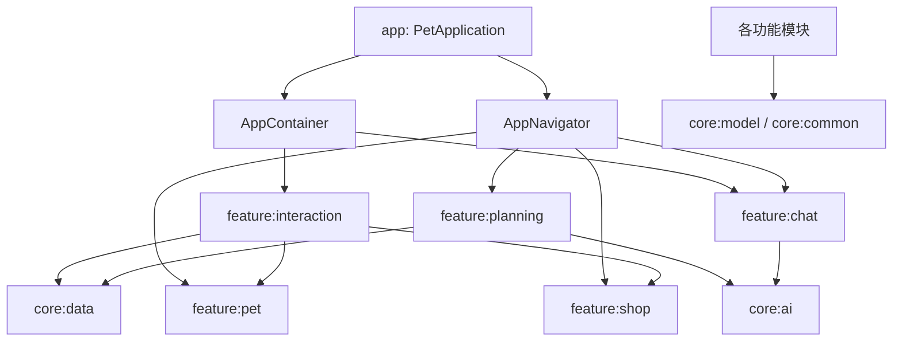
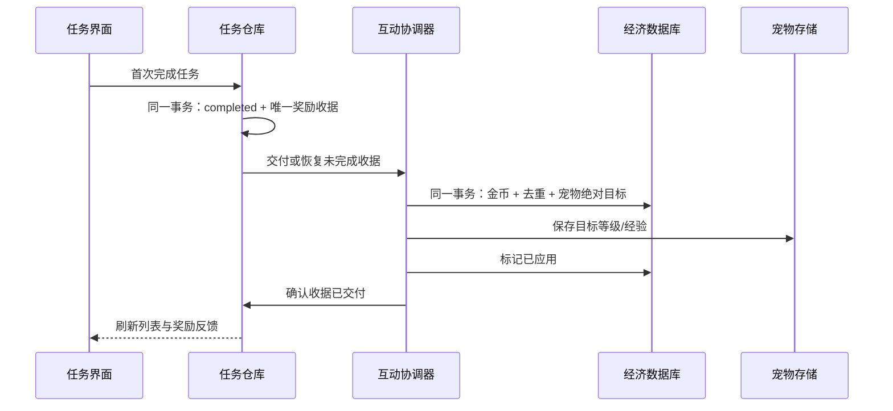

# 当前架构

## 模块边界

项目包含一个应用模块、四个 core 模块和五个 feature 模块。界面使用 Activity / Fragment、XML、自定义 View；状态通过 ViewModel / LiveData 发布，不引入新的框架或改变现有业务规则。

| 模块 | 职责 | 主要边界 |
| --- | --- | --- |
| app | Application、依赖生命周期、跨功能路由、集成测试 | AppContainer 装配实例，AppNavigator 创建 Intent |
| core:model | Pet、Task、物品和奖励契约 | 不依赖 Android 界面或具体功能实现 |
| core:data | 任务 SQLite、TaskRepository、任务奖励 outbox | 不直接依赖宠物或商城 |
| core:common | 共享磁盘队列、日期和回调工具 | 为业务与界面提供基础设施 |
| core:ai | LLM HTTP 请求、取消、错误转换 | 不持有聊天历史或界面 |
| feature:planning | 备忘录、任务输入/筛选、拆解、提醒和通知 | 通过宿主取得 TaskRepository |
| feature:chat | 聊天历史、发送/重试状态和界面 | Repository 由宿主提供，网络由 core:ai 执行 |
| feature:pet | 本地宠物仓库、经验成长、首页与穿戴渲染 | 通过 PetRepositoryOwner / PetInteractionOwner 获取能力 |
| feature:shop | 商品、购买、钱包、库存和经济数据库 | 使用宿主提供的宠物等级和互动契约 |
| feature:interaction | 奖励、喂食、装备的协调与恢复 | 连接任务收据、经济事务和宠物仓库 |

主要依赖关系如下，公共 model/common 依赖在图中合并表示：

pet 与 shop 不互相引用。宿主实现既有 Owner 接口，按需创建共享实例；AppContainer 不在构造时访问数据库。AppNavigator 集中处理已有目标 Activity、Intent 参数和返回栈标记，不承担业务计算。

## 状态与线程

UI 命令进入 ViewModel，在 AppExecutors 的共享后台队列执行存储操作，完成后切回主线程发布 LiveData。ChatRepository 保留主线程所有权，网络请求由 OkHttp 执行。SQLite 与宠物仓库操作禁止在主线程执行。

首页 MainActivity 复用 PetActivity；PetCareSheet 是页面内 Fragment，与首页共享 PetCareViewModel。抽屉覆盖底部操作区而不重新分配场景空间。全页 PetLandscapeView 负责背景缩放，PetAvatarView 绘制原小牛与头部/颈部/身体穿戴层。

## 数据来源

| 数据 | 唯一持久来源 |
| --- | --- |
| 任务、完成时间、提醒时间 | pet_planner.db 的 tasks |
| 首次完成的奖励及交付状态 | 同库 task_reward_outbox，任务 ID 唯一 |
| 钱包、库存与 equipped 标记 | economy.db 的 wallet / inventory |
| 金币去重、购买去重 | rewards / purchases |
| 待恢复的喂食状态、奖励目标 | pet_interactions / task_rewards |
| 宠物基础形象、等级、经验、心情、饱腹度 | LocalPetRepository 的 SharedPreferences |
| 聊天消息与历史 | PreferencesChatHistoryStore |

任务库与经济库均为 v4，使用增量迁移，不清空已有数据。宠物基础形象 ID 不作为服装 ID；穿戴只读写 inventory.equipped，同部位替换，其他部位保留。

## 任务奖励与互动恢复

PetInteractionCoordinator 同时是对外的受保护 PetRepository。每次读取或修改宠物之前先恢复日志，完成后才计算下一笔状态，避免未确认的旧目标覆盖后续奖励。发奖重试使用稳定 source；喂食/装备重试使用稳定 request ID，不能随意更换请求标识。

喂食先在经济库同一事务中扣库存并记录目标心情/饱腹度，再保存宠物状态并确认。重复恢复写入绝对目标，不重复累加或扣库存。失败时 UI 保留错误/重试状态。

## 后续维护约定

- 通过宿主提供的仓库修改数据，不自行创建第二个裸宠物仓库或并行的钱包状态。
- 新增服装需同步商品目录、PetOutfits 部位映射、ProductArt 与 PetAvatarView 绘制映射。
- 不改已有 Activity 类名、应用 ID、持久化键、数据库表或请求来源规则来做单纯的代码整理。
- 运行中的首页使用 activity_pet_home.xml 和 PetCareViewModel；保留的旧布局/兼容 ViewModel 不作为当前界面入口。
